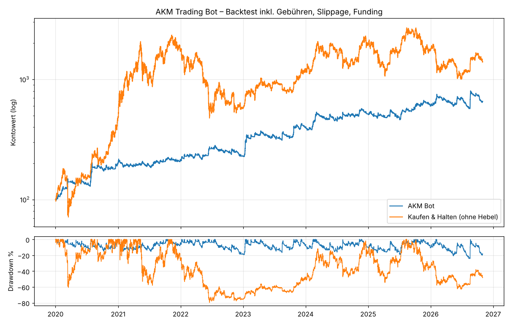

# AKM Trading Bot – Backtest-Bericht

Zeitraum: 01.01.2020 – 31.10.2026 · Märkte: BTCUSDT, ETHUSDT · Zeitrahmen: 4h
Strategie: Donchian-Ausbruch 20 Kerzen, EMA-200-Trendfilter, Stop 3.0 ATR (nachgezogen), Long + Short
Risiko: 1.5% pro Trade, max. 2.0x Hebel gesamt
Kosten: 0.06% Gebühr + 0.03% Slippage pro Order, echte historische Funding-Raten

## Ergebnis Standard-Einstellung

| | Startwert | Endwert | Gesamtrendite | Rendite p.a. (CAGR) | Max. Drawdown | Sharpe | Sortino | Rendite/Drawdown | Trades | Trefferquote | Profit-Faktor | Gebühren gesamt | Funding gesamt |
|---|---|---|---|---|---|---|---|---|---|---|---|---|---|
| AKM Bot | 100.0 | 654.7 | +554.7% | +31.7% | -23.6% | 1.13 | 2.12 | 1.34 | 582 | 39% | 1.4 | 86.05 | 55.68 |
| Kaufen & Halten | 99.98 | 1402.43 | +1302.7% | +47.2% | -77.9% | 0.91 | 1.21 | 0.61 |  |  |  |  |  |

## Hebel-Stufen im Vergleich

| | Endwert | Rendite p.a. (CAGR) | Max. Drawdown | Sharpe | Gebühren gesamt | Funding gesamt |
|---|---|---|---|---|---|---|
| Vorsichtig (0,5 %, 1x) | 211.29 | +11.6% | -8.5% | 1.19 | 12.12 | 10.64 |
| Ohne Hebel (1 %, 1x) | 375.76 | +21.4% | -16.4% | 1.13 | 37.1 | 27.84 |
| STANDARD (1,5 %, max 2x) | 654.7 | +31.7% | -23.6% | 1.13 | 86.05 | 55.68 |
| Aggressiv (2 %, max 2x) | 745.95 | +34.2% | -42.3% | 1.02 | 161.2 | 92.4 |
| Zocker (3 %, max 3x) | 886.57 | +37.6% | -57.1% | 0.89 | 348.27 | 217.37 |

## Funktioniert es auch in einem anderen Zeitraum?

| | Rendite p.a. (CAGR) | Max. Drawdown | Sharpe | Trades |
|---|---|---|---|---|
| 2020–2022 | +32.2% | -17.7% | 1.18 | 253 |
| 2023–heute | +31.7% | -23.6% | 1.11 | 328 |

## Jahresrenditen

| | Bot | Kaufen & Halten |
|---|---|---|
| 2020 | +101.6% | +383.8% |
| 2021 | +6.4% | +258.2% |
| 2022 | +7.8% | -66.9% |
| 2023 | +71.5% | +103.9% |
| 2024 | +28.6% | +64.9% |
| 2025 | +17.6% | -9.4% |
| 2026 | +9.3% | -19.7% |

> Vergangene Ergebnisse sind keine Garantie. Der Backtest nutzt Futures-Kurse von Binance;
> echte Ausführung, Ausfälle und Börsenregeln können schlechter sein.
